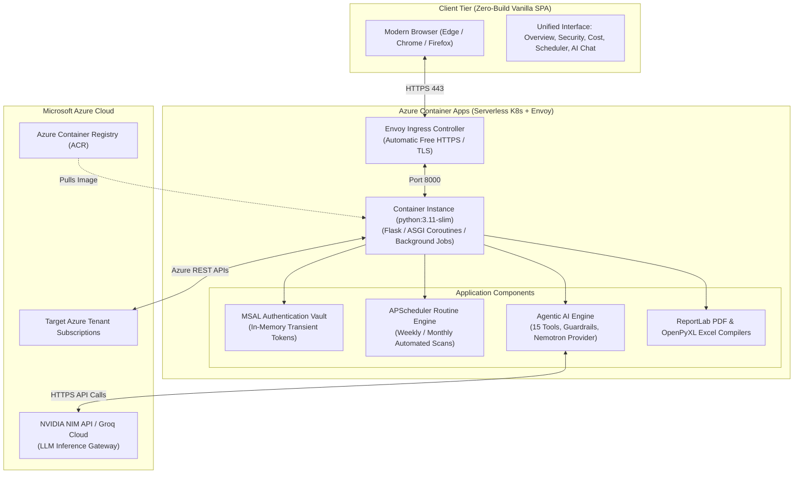

# Azure FinSecOps Platform: End-to-End Azure Container Apps (ACA) Deployment & Operations Guide

> **Document Version:** 3.0.0  
> **Platform Version:** 3.0.0 (Enterprise Multi-Tenant)  
> **Architecture:** Serverless Containerized Cloud Governance & Financial Operations Engine  
> **Scope:** Cloud Deployment Blueprint, Platform Architecture & Dynamic Assessment Fetching Reference  

---

## Table of Contents
1. [Executive Summary & Platform Capabilities](#1-executive-summary--platform-capabilities)
2. [Platform Architecture & System Workflow](#2-platform-architecture--system-workflow)
3. [The 32 Core Evaluation Modules & Dynamic Azure Telemetry Fetching](#3-the-32-core-evaluation-modules--dynamic-azure-telemetry-fetching)
   - [3.1 Security Governance Modules (SEC-01 through SEC-14)](#31-security-governance-modules-sec-01-through-sec-14)
   - [3.2 Financial Optimization Modules (COST-01 through COST-18)](#32-financial-optimization-modules-cost-01-through-cost-18)
4. [Agentic AI Engine & Multi-Provider Architecture](#4-agentic-ai-engine--multi-provider-architecture)
5. [Prerequisites & Environment Setup](#5-prerequisites--environment-setup)
6. [Step-by-Step Deployment to Azure Container Apps (PowerShell / Azure CLI)](#6-step-by-step-deployment-to-azure-container-apps)
   - [Step 0: Install and Log In to Azure CLI](#step-0-install-and-log-in-to-azure-cli)
   - [Step 1: Set Project Deployment Variables](#step-1-set-project-deployment-variables)
   - [Step 2: Create Azure Resource Group](#step-2-create-azure-resource-group)
   - [Step 3: Create Azure Container Registry (ACR)](#step-3-create-azure-container-registry-acr)
   - [Step 4: Build Container Image via ACR Cloud Build (No Docker Needed)](#step-4-build-container-image-via-acr-cloud-build)
   - [Step 5: Create Azure Container Apps Environment](#step-5-create-azure-container-apps-environment)
   - [Step 6: Deploy Container App with Secrets & Environment Variables](#step-6-deploy-container-app-with-secrets--environment-variables)
   - [Step 7: Verify Live HTTPS Endpoint](#step-7-verify-live-https-endpoint)
7. [Continuous Deployment (Zero-Downtime Rolling Updates)](#7-continuous-deployment-zero-downtime-rolling-updates)
8. [Production Hardening: Custom Domains with Free Managed SSL/TLS](#8-production-hardening-custom-domains-with-free-managed-ssltls)
9. [Operational Monitoring & Diagnostics](#9-operational-monitoring--diagnostics)

---

## 1. Executive Summary & Platform Capabilities

The **Azure FinSecOps Platform** is an enterprise-grade cloud governance and financial optimization suite designed to solve two mission-critical cloud challenges:
1. **Security Posture & Compliance**: Eliminating attack paths, insecure configurations, and unmonitored assets while systematically improving Microsoft Defender for Cloud Secure Scores.
2. **Financial Efficiency & Cloud FinOps**: Uncovering non-disruptive, mathematically defensible monthly and annualized cloud savings across virtual machines, storage accounts, databases, snapshots, and serverless runtimes.

```mermaid
flowchart LR
    subgraph Ingestion["Live Azure Telemetry Ingestion (100% Read-Only)"]
        ARM["ARM REST APIs\n(Compute, Storage, Network, SQL, IAM)"]
        ARG["Azure Resource Graph (KQL)\n(securityresources, subassessments)"]
        Defender["Microsoft Defender for Cloud\n(ascScore, Controls, Attack Paths)"]
        Health["Azure Resource Health\n(Live Deprecations & Retirements)"]
        CostAPI["Azure Cost Management API\n(Pre-Tax Spend, Billing Amortization)"]
        Metrics["Azure Monitor Metrics\n(CPU, IOPS, Network, Storage)"]
    end

    subgraph CoreEngine["Platform Core Engines"]
        SecModules["14 Security Modules\n(SEC-01 to SEC-14)"]
        CostModules["18 FinOps Modules\n(COST-01 to COST-18)"]
        AgenticAI["Agentic AI Orchestrator\n(NVIDIA Nemotron / Groq / OpenAI)"]
        Deduplicator["Cross-Module Deduplicator\n(High-Confidence Synthesis)"]
    end

    subgraph Deliverables["Executive Deliverables"]
        Dashboard["Unified Web Workspace\n(Real-Time Analytics & AI Copilot)"]
        PDF["Landscape Boardroom PDF\n(ReportLab Vector Architecture)"]
        Excel["Multi-Tab Financial Excel\n(OpenPyXL Structured Workbooks)"]
    end

    Ingestion --> CoreEngine
    CoreEngine --> Deliverables
```



### Key Architectural Strengths
* **100% Agentless & Non-Invasive**: Connects exclusively via standard Azure Management REST APIs using read-only role permissions (`Reader`, `Security Reader`, `Cost Management Reader`). No virtual machine extensions, host daemons, or write operations are ever required.
* **Zero Hardcoded Timestamps or Static Baselines**: All service retirements, runtime deprecations, OS lifecycles, and tenant currencies (₹ INR, $, €, £) are queried dynamically from live Azure API endpoints.
* **Deterministic Financial Modeling**: Replaces naive "Month-to-Date $\times$ 12" formulas with mathematical delta right-sizing, off-peak idle deallocation (128 weekly off-hours), and storage redundancy tier comparisons.
* **Container-Native High Performance**: Fully containerized using an asynchronous Python backend, ASGI coroutines, and an ultra-responsive client-side SPA.

---

## 2. Platform Architecture & System Workflow

The solution is packaged as a portable Docker container hosting the web dashboard, asynchronous scan orchestrator, AI agentic copilot, and deliverable report compilers:



---

## 3. The 32 Core Evaluation Modules & Dynamic Azure Telemetry Fetching

The platform executes **32 proprietary assessment modules** (14 Security Posture modules and 18 Financial Optimization modules). Every module fetches live data directly from Azure without static dummy fallbacks.

### 3.1 Security Governance Modules (SEC-01 through SEC-14)

| Module Code | Assessment Name | Primary Data Sources & APIs | Dynamic Value Fetching & Evaluation Logic |
| :--- | :--- | :--- | :--- |
| **`SEC-01`** | **Subscription Security Score** | `Microsoft.Security/secureScores/ascScore`<br>`Microsoft.Security/secureScores/ascScore/secureScoreControls` (2020-01-01) | Calls Defender Secure Score API to retrieve authoritative score current, max, and percentage values. Queries individual controls, computing exact control percentages (`current / max * 100`) and potential subscription score improvements. Renders the Overall Secure Score in a separate dedicated card above control breakdowns. |
| **`SEC-02`** | **New Security Recommendations** | `Microsoft.Security/assessments` (2021-06-01)<br>`properties.status.firstEvaluationDate` | Queries active assessments, filtering strictly to unresolved (`Unhealthy` or `Open`) recommendations detected within the last 30 days (`<= 30` days). Parses ISO timestamps into clean `YYYY-MM-DD` detection dates. |
| **`SEC-03`** | **Resources Missing Diagnostic Logs** | `Microsoft.Insights/diagnosticSettings`<br>`Microsoft.Resources/subscriptions/resources` | Audits diagnostic settings across critical production workloads: Logic Apps (`microsoft.logic/workflows`), Key Vaults (`microsoft.keyvault/vaults`), App Services (`microsoft.web/sites`), Microsoft Foundry resources (`cognitiveservices`, `machinelearningservices`, `aistudio`), and Kubernetes clusters (`managedclusters`). Gaps are flagged if settings are absent, log categories are disabled, or no Log Analytics Workspace target is configured. |
| **`SEC-04`** | **High Priority Azure Security Findings** | Azure Resource Graph (`securityresources`)<br>`Microsoft.Security/assessmentMetadata` (2021-06-01) | Leverages KQL on `securityresources` to fetch High severity recommendations matching the Azure Portal Recommendations blade. Strips assessment sub-resource path tails to resolve the true target resource, true resource group, and actual resource name. Uses cached assessment metadata to ensure 100% dynamic description, remediation guidance, and related security controls without placeholders. |
| **`SEC-05`** | **Service Retirement & Deprecations** | `Microsoft.ResourceHealth/events`<br>`Microsoft.Advisor/recommendations`<br>Azure Resource Graph | Queries official Azure Advisor Service Upgrade & Retirement advisories and live Azure Resource Health / Service Health planned deprecation events. Eliminates synthetic scans over unflagged standard resources. Incorporates `tls` and `tlc` deprecation tracking to flag retiring security protocols dynamically. |
| **`SEC-06`** | **High Security Alerts** | `Microsoft.Security/alerts` (2022-01-01) | Audits active Defender security alerts, filtering to `High` and `Critical` severity threats. Extracts attacker MITRE ATT&CK tactics, techniques, compromised entities, and remediation instructions. |
| **`SEC-07`** | **Azure Security Attack Path Findings** | `Microsoft.Security/attackPaths`<br>Azure Resource Graph `securityresources` | Analyzes Defender CSPM graph-based lateral movement vectors. Maps internet-exposed entry points, lateral traversal techniques, and high-value target assets with actionable break-the-chain remediation. |
| **`SEC-08`** | **Virtual Machines Running Outdated OS** | `Microsoft.Compute/virtualMachines`<br>`Microsoft.Compute/virtualMachines/instanceView` | Evaluates VM guest operating system versions against a modern **2025 baseline**. Flags any Windows Server release prior to 2025 (2022, 2019, 2016, 2012, 2008) or Linux distribution releases prior to 2025 (Ubuntu <= 24.04 LTS, CentOS, RHEL <= 9). Displays the 8 streamlined columns: Subscription Name, Resource Group Name, Virtual Machine Name, Region, Operating System, OS Version, OS Build (dynamically resolved from instanceView/SKU), and Publisher. |
| **`SEC-09`** | **VM Patching / Missing Patches** | `Microsoft.Compute/virtualMachines/patchAssessmentResults/latest` | Inspects live Azure Update Manager and VM guest patch assessments. Identifies pending critical/security patches and outstanding reboots. |
| **`SEC-10`** | **Outdated Software Versions on VMs** | Defender Vulnerability Management (`subassessments`) via ARG | Queries vulnerability subassessments on virtual machines. Filters strictly to items whose recommendation or package name starts with `"Update"` to focus exclusively on actionable package upgrade tasks. |
| **`SEC-11`** | **Managed Disk Encryption Configuration Gaps** | `Microsoft.Compute/disks`<br>`Microsoft.Compute/virtualMachines` (`securityProfile`) | Audits managed disk encryption settings for Customer-Managed Keys (CMK) and Azure Disk Encryption (ADE). Dynamically queries attached virtual machines to resolve live `securityProfile.encryptionAtHost` status rather than assuming disabled. |
| **`SEC-12`** | **Azure Services Using Insecure TLS** | `Microsoft.Storage/storageAccounts`<br>`Microsoft.Web/sites`<br>`Microsoft.Sql/servers`<br>`Microsoft.DocumentDB/databaseAccounts` | Inspects minimum TLS configurations across Storage Accounts, Web Apps, SQL Servers, and Cosmos DB. Flags resources allowing legacy TLS 1.0 or 1.1 connections. |
| **`SEC-13`** | **Key Vault RBAC Migration** | `Microsoft.KeyVault/vaults`<br>`Microsoft.Authorization/roleAssignments` | Audits Key Vault authorization models (`enableRbacAuthorization`). Dynamically queries Azure IAM at the vault scope to report real role assignment counts and assigned role names, recommending migration from legacy access policies. |
| **`SEC-14`** | **Contributor Role Assignments Review** | `Microsoft.Authorization/roleAssignments`<br>`Microsoft.Authorization/roleDefinitions` | Audits broad Contributor privileges across subscriptions and resource groups. Filters strictly to **Contributor assignments only** (excluding Owner) to enforce least-privilege principles and eliminate direct user assignments. |

---

### 3.2 Financial Optimization Modules (COST-01 through COST-18)

| Module Code | Assessment Name | Primary Data Sources & APIs | Dynamic Value Fetching & Evaluation Logic |
| :--- | :--- | :--- | :--- |
| **`COST-01`** | **Underutilized Virtual Machines** | `Microsoft.Compute/virtualMachines`<br>`Microsoft.Insights/metrics` (CPU, Network) | Evaluates 7-day P95 CPU utilization and network I/O. VMs running with average CPU < 5% are classified as idle/underutilized. Rightsizing models compute the savings delta between current SKU and target SKU. |
| **`COST-02`** | **Orphan & Unattached Cloud Resources** | `Microsoft.Network/publicIPAddresses`<br>`Microsoft.Compute/disks`<br>`Microsoft.Network/networkInterfaces`<br>`Microsoft.Network/networkSecurityGroups` | Identifies unattached managed disks (`managedBy == null`), unassociated Public IPs (`ipConfiguration == null`), detached NICs, and empty route tables. Computes monthly leakage using real resource SKU rates. |
| **`COST-03`** | **Underutilized Managed Data Disks** | `Microsoft.Compute/disks`<br>`Microsoft.Insights/metrics` (Composite Disk IOPS / BPS) | Tracks 7-day disk read/write bandwidth and IOPS. Flags over-provisioned Premium SSD data disks where Standard SSD or Standard HDD satisfies workload requirements. |
| **`COST-04`** | **Underutilized Operating System Disks** | `Microsoft.Compute/virtualMachines`<br>`Microsoft.Compute/disks` | Evaluates attached OS disk performance. Flags non-production or low-throughput VMs configured with oversized Premium SSD OS disks, calculating savings from tiering down to Standard SSD. |
| **`COST-05`** | **Monthly Billing & Service Analysis** | `Microsoft.CostManagement/query` (Amortized / Pre-Tax) | Executes dynamic Cost Management queries grouping spend by Service Name and Resource Group across billing periods. Automatically discovers and applies tenant currency (e.g., INR `₹`, USD `$`, EUR `€`). |
| **`COST-06`** | **Top 20 Optimization Opportunities** | Cross-Module Aggregation & Cost Ranking | Ranks the top 20 highest-impact cost reduction opportunities across the estate by monthly financial recovery, providing immediate executive triage. |
| **`COST-07`** | **VM Licensing & Azure Hybrid Benefit (AHB)** | `Microsoft.Compute/virtualMachines`<br>`properties.licenseType` | Scans Windows Server and enterprise Linux VMs for missing Azure Hybrid Benefit (`licenseType: Windows_Server`). Calculates licensing savings from applying existing on-premises software assurance. |
| **`COST-08`** | **Virtual Machine Auto-Shutdown Enforcement** | `Microsoft.DevTestLab/schedules`<br>`Microsoft.Compute/virtualMachines` | Identifies non-production virtual machines lacking scheduled auto-shutdown policies. Calculates defensible savings based on 128 weekly off-hours (evenings and weekends): $\text{Hourly Rate} \times 128 \times 4.33$. |
| **`COST-09`** | **Managed Disk Capacity & Utilization Alert** | `Microsoft.Compute/disks` (`diskSizeGB`) | Detects grossly oversized managed disks (e.g. 1 TB+ disks provisioned for basic workloads). Recommends volume compaction and rightsized disk provisioning. |
| **`COST-10`** | **Database CPU / DTU Sizing Thresholds** | `Microsoft.Sql/servers/databases`<br>`Microsoft.Insights/metrics` (CPU/DTU P95) | Analyzes Azure SQL and flexible databases with P95 DTU/CPU utilization below 10%. Models tier downscale savings to appropriately sized service objectives. |
| **`COST-11`** | **Recently Provisioned Unused Resources** | `Microsoft.Resources/subscriptions/resources`<br>`Microsoft.Insights/metrics` | Audits newly provisioned resources created within the last 14–30 days showing zero network, CPU, or transaction activity, catching forgotten proof-of-concept deployments before billing accrues. |
| **`COST-12`** | **Storage Account Lifecycle Policy Rules** | `Microsoft.Storage/storageAccounts/managementPolicies` | Audits blob lifecycle rules. Flags storage accounts where lifecycle policies do not exist or where all tiering rules are disabled, enabling automated transition to Cool and Archive tiers. |
| **`COST-13`** | **Database Allocated vs Actual Usage** | `Microsoft.Sql/servers/databases`<br>`allocated_data_storage` vs `storage` metrics | Detects SQL databases where allocated file space vastly exceeds used data space, recommending automated shrink operations and right-sized storage caps. |
| **`COST-14`** | **Azure Backup Policy & Retention Alignment** | `Microsoft.RecoveryServices/vaults`<br>`backupPolicies` | Audits Recovery Services Vault policies for excessive retention (e.g. daily backups retained for 5+ years on test workloads). Recommends optimized retention tiers to minimize backup storage fees. |
| **`COST-15`** | **Old & Stale Managed Disk Snapshots** | `Microsoft.Compute/snapshots` (`timeCreated`) | Scans managed disk snapshots older than 90–365 days. Computes monthly accrued snapshot storage costs and flags unreferenced legacy recovery points. |
| **`COST-16`** | **Function App Hosting Plan & Execution Time** | `Microsoft.Web/sites` (`kind: functionapp`)<br>`Microsoft.Web/serverfarms` | Evaluates Azure Function apps running on dedicated App Service Plans (B1/P1v2) with minimal execution frequency, recommending migration to serverless Consumption plans. |
| **`COST-17`** | **VM Auto-Start Schedule & Off-Hours Impact** | `Microsoft.Compute/virtualMachines`<br>Azure Activity Log & Schedules | Identifies virtual machines configured with automated start routines that fail to auto-shutdown, resulting in unintended weekend and off-hour billing. |
| **`COST-18`** | **Non-LRS Storage Redundancy Optimization** | `Microsoft.Storage/storageAccounts` (`sku.name`) | Scans non-production storage accounts configured with redundant Geo-Redundant (GRS) or Zone-Redundant (ZRS) storage. Calculates savings from switching to Locally-Redundant Storage (LRS). |

---

## 4. Agentic AI Engine & Multi-Provider Architecture

The platform features an integrated **Autonomous AI Cloud Analyst** powered by an agentic tool-calling architecture:

```mermaid
flowchart TD
    UserQuery["User Prompt\n(e.g. 'Audit stopped VMs and check Key Vault compliance')"] --> Orchestrator["FinSecOps Agent Orchestrator"]
    Orchestrator --> Guardrails["FinSecOps Security Guardrails\n(Strict Read-Only Enforcement / GET-Only ARM / Secret Redaction)"]
    Guardrails --> Provider["Universal Multi-Provider Gateway"]

    subgraph LLMProviders["Supported LLM Providers"]
        Nemotron["NVIDIA Nemotron 3.5 Super VL 120B\n(Model: nvidia/nemotron-3.5-super-vl-120b-a12b via NIM)"]
        Groq["Groq Cloud\n(Model: openai/gpt-oss-120b / llama-3.3-70b)"]
        OpenAI["OpenAI\n(gpt-4o / gpt-4o-mini)"]
        Gemini["Google Gemini\n(gemini-1.5-pro / gemini-2.0)"]
        Claude["Anthropic Claude\n(claude-3-5-sonnet-20241022)"]
    end

    Provider --> LLMProviders
    LLMProviders --> ToolCall["Agent Selects Autonomous Tools (15 Available)"]

    subgraph ToolRegistry["Enterprise Tool Registry"]
        T1["azure_get_vm_inventory"]
        T2["azure_get_storage_accounts"]
        T3["azure_get_cost_summary"]
        T4["azure_get_security_posture"]
        T5["azure_generic_arm_query (Dynamic ARM Explorer)"]
        T6["azure_run_assessment_module (Dynamic Module Runner)"]
        T7["azure_dynamic_environment_analyst (Real-Time Cloud Diagnostics)"]
        TMore["+ 8 Domain-Specific Tools"]
    end

    ToolCall --> ToolRegistry
    ToolRegistry --> ARMExecution["Execute Read-Only Azure API Call"]
    ARMExecution --> ContextSynthesis["Synthesize Live Data into Executive Response"]
    ContextSynthesis --> UserReply["Final Structured Markdown Deliverable"]
```



### Safety & Guardrail Guarantees
- **Strict Read-Only Operations**: Write, delete, or modify actions (`POST`, `PUT`, `DELETE`, `PATCH`, `stop`, `deallocate`, `delete`) are blocked at the guardrail layer.
- **Dynamic Tool Registration**: In addition to 12 predefined tools, the agent features 3 dynamic tools (`azure_generic_arm_query`, `azure_run_assessment_module`, and `azure_dynamic_environment_analyst`) allowing it to investigate uncataloged Azure resource types dynamically.
- **Secret Redaction**: API keys (including NVIDIA `nvapi-` tokens and Groq keys) are scrubbed before prompt execution.

---

## 5. Prerequisites & Environment Setup

Before starting deployment, confirm you have:
1. **Azure Subscription**: Active subscription with `Owner` or `Contributor` permissions to create a Resource Group, ACR, and Container App.
2. **Azure CLI**: Installed locally on your computer ([Install Azure CLI](https://learn.microsoft.com/en-us/cli/azure/install-azure-cli)).
3. **No Local Docker Needed**: Build operations run serverless in Azure Container Registry using `az acr build`.
4. **AI Inference Credentials**: An API key from either NVIDIA NIM ([build.nvidia.com](https://build.nvidia.com)) or Groq Cloud ([console.groq.com](https://console.groq.com)).

---

## 6. Step-by-Step Deployment to Azure Container Apps

Open **PowerShell** on Windows (or Bash on macOS/Linux) and follow these exact steps:

### Step 0: Install and Log In to Azure CLI
```powershell
# 1. Log in to Azure
az login

# 2. Verify active subscription
az account show --output table

# 3. Register Container Apps & ACR resource providers
az extension add --name containerapp --upgrade
az provider register --namespace Microsoft.App
az provider register --namespace Microsoft.OperationalInsights
az provider register --namespace Microsoft.ContainerRegistry
```

### Step 1: Set Project Deployment Variables
```powershell
# Navigate to the project root directory
cd c:\Users\mnave\OneDrive\Desktop\Azure

# Set deployment configuration variables
$RESOURCE_GROUP   = "rg-finsecops-prod"
$LOCATION         = "eastus"                 # Or westeurope, centralindia, uksouth
$ACR_NAME         = "acrfinsecops$((Get-Random -Minimum 1000 -Maximum 9999))" # Unique alphanumeric
$ENVIRONMENT_NAME = "cae-finsecops-env"
$APP_NAME         = "azure-finsecops-app"
$CONTAINER_PORT   = 8000
```

### Step 2: Create Azure Resource Group
```powershell
az group create `
  --name $RESOURCE_GROUP `
  --location $LOCATION
```

### Step 3: Create Azure Container Registry (ACR)
```powershell
az acr create `
  --resource-group $RESOURCE_GROUP `
  --name $ACR_NAME `
  --sku Basic `
  --admin-enabled true
```

### Step 4: Build Container Image via ACR Cloud Build
Run the cloud build command from the workspace directory. Azure packages your application, resolves dependencies from `requirements.txt`, and generates the Linux container image:
```powershell
az acr build `
  --registry $ACR_NAME `
  --image azure-finsecops:v3.0 .
```

### Step 5: Create Azure Container Apps Environment
```powershell
az containerapp env create `
  --name $ENVIRONMENT_NAME `
  --resource-group $RESOURCE_GROUP `
  --location $LOCATION
```

### Step 6: Deploy Container App with Secrets & Environment Variables

#### 1. Retrieve ACR Credentials
```powershell
$ACR_SERVER = az acr show --name $ACR_NAME --query loginServer --output tsv
$ACR_PASSWORD = az acr credential show --name $ACR_NAME --query "passwords[0].value" --output tsv
```

#### 2. Deploy Container App (Choose Option A for Nemotron or Option B for Groq)

##### Option A: Deploying with NVIDIA Nemotron (Recommended)
```powershell
az containerapp create `
  --name $APP_NAME `
  --resource-group $RESOURCE_GROUP `
  --environment $ENVIRONMENT_NAME `
  --image "$ACR_SERVER/azure-finsecops:v3.0" `
  --target-port $CONTAINER_PORT `
  --ingress external `
  --registry-server $ACR_SERVER `
  --registry-username $ACR_NAME `
  --registry-password $ACR_PASSWORD `
  --cpu 1.0 `
  --memory 2.0Gi `
  --min-replicas 1 `
  --max-replicas 3 `
  --env-vars `
    AI_PROVIDER="nemotron" `
    NEMOTRON_API_KEY="<YOUR_NVIDIA_NEMOTRON_API_KEY>" `
    NEMOTRON_MODEL="nvidia/nemotron-3.5-super-vl-120b-a12b" `
    NEMOTRON_BASE_URL="https://integrate.api.nvidia.com/v1" `
    APP_HOST="0.0.0.0" `
    APP_PORT="8000"
```

##### Option B: Deploying with Groq Cloud
```powershell
az containerapp create `
  --name $APP_NAME `
  --resource-group $RESOURCE_GROUP `
  --environment $ENVIRONMENT_NAME `
  --image "$ACR_SERVER/azure-finsecops:v3.0" `
  --target-port $CONTAINER_PORT `
  --ingress external `
  --registry-server $ACR_SERVER `
  --registry-username $ACR_NAME `
  --registry-password $ACR_PASSWORD `
  --cpu 1.0 `
  --memory 2.0Gi `
  --min-replicas 1 `
  --max-replicas 3 `
  --env-vars `
    AI_PROVIDER="groq" `
    GROQ_API_KEY="<YOUR_GROQ_API_KEY>" `
    GROQ_MODEL="openai/gpt-oss-120b" `
    GROQ_BASE_URL="https://api.groq.com/openai/v1" `
    APP_HOST="0.0.0.0" `
    APP_PORT="8000"
```

> [!TIP]
> **Resource Sizing Recommendation**: We allocate `1.0 vCPU` and `2.0 GiB` of RAM. This provides smooth, low-latency performance during parallel assessment runs and on-the-fly vector PDF and multi-tab Excel compilation.

### Step 7: Verify Live HTTPS Endpoint
```powershell
$APP_URL = az containerapp show `
  --name $APP_NAME `
  --resource-group $RESOURCE_GROUP `
  --query properties.configuration.ingress.fqdn `
  --output tsv

Write-Host "==========================================================" -ForegroundColor Green
Write-Host "Live FinSecOps Production URL:" -ForegroundColor Yellow
Write-Host "https://$APP_URL" -ForegroundColor Cyan
Write-Host "==========================================================" -ForegroundColor Green
```

Open the generated HTTPS URL in any browser to access the complete application.

---

## 7. Continuous Deployment (Zero-Downtime Rolling Updates)

Whenever code or templates are updated, deploying a new release requires only two commands:

```powershell
# 1. Build new image revision
az acr build --registry $ACR_NAME --image azure-finsecops:v3.1 .

# 2. Update Container App (seamless rolling update)
az containerapp update `
  --name $APP_NAME `
  --resource-group $RESOURCE_GROUP `
  --image "$ACR_SERVER/azure-finsecops:v3.1"
```

Azure Container Apps starts the new container, verifies health probes, and shifts traffic over Envoy without dropping a single active HTTP session.

---

## 8. Production Hardening: Custom Domains with Free Managed SSL/TLS

To bind an enterprise custom domain (e.g. `finsecops.yourcompany.com`):

### 1. Configure DNS Records with Your Domain Registrar
Add these two records in your DNS management dashboard:
* **CNAME Record**: Name: `finsecops`, Value: `<YOUR_APP_NAME>.<REGION>.azurecontainerapps.io`
* **TXT Record**: Name: `asuid.finsecops`, Value: `<CUSTOM_DOMAIN_VERIFICATION_ID>` *(found in Azure Portal -> Container App -> Custom Domains)*

### 2. Bind Domain and Provision Free Managed Certificate via CLI
```powershell
# Add hostname
az containerapp hostname add `
  --name $APP_NAME `
  --resource-group $RESOURCE_GROUP `
  --hostname "finsecops.yourcompany.com"

# Bind auto-renewing free DigiCert certificate
az containerapp hostname bind `
  --name $APP_NAME `
  --resource-group $RESOURCE_GROUP `
  --hostname "finsecops.yourcompany.com" `
  --environment $ENVIRONMENT_NAME `
  --validation-method CNAME
```

---

## 9. Operational Monitoring & Diagnostics

### Real-Time Live Log Streaming
```powershell
az containerapp logs show `
  --name $APP_NAME `
  --resource-group $RESOURCE_GROUP `
  --follow
```

### Updating Secrets & Environment Variables On-the-Fly
```powershell
az containerapp update `
  --name $APP_NAME `
  --resource-group $RESOURCE_GROUP `
  --set-env-vars AI_PROVIDER="nemotron" NEMOTRON_API_KEY="<NEW_KEY>"
```

### Complete Environment Clean-Up (Disaster Recovery / Teardown)
To remove all deployed infrastructure and stop all billing:
```powershell
az group delete --name $RESOURCE_GROUP --yes --no-wait
```
