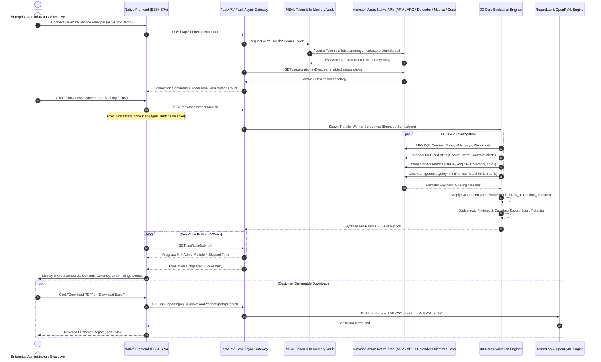

# Azure Cloud Governance & FinOps Platform

> **Enterprise Financial Optimization & Security Posture Governance Platform for Microsoft Azure**  
> *Deterministic Telemetry Correlation • 33 Proprietary Assessment Modules • 1-Click Continuous Intelligence*

---

## 📌 Executive Summary & Strategic Value Proposition

Modern enterprise organizations operating in Microsoft Azure face a persistent operational dichotomy: **cloud security risks proliferate rapidly**, while **cloud infrastructure spending accelerates unchecked**.

### The Traditional Manual Cloud Audit Dilemma
Traditionally, assessing an enterprise cloud footprint across dozens of subscriptions requires engaging a specialized team of 3 to 5 senior cloud consultants over a 2 to 4 week engagement. This conventional approach carries critical liabilities:
* **Prohibitive Time & Cost:** Manual audits cost tens of thousands of dollars and consume hundreds of engineering hours compiling disjointed portal screenshots and PowerShell outputs.
* **Point-in-Time Stale Telemetry:** By the time a manual spreadsheet report is delivered to leadership, cloud engineers have already provisioned new resources, rendering the findings obsolete.
* **Naive, Indefensible Financial Math:** Manual audits typically multiply Month-to-Date (MTD) charges by 12, yielding inflated, indefensible projections that fail CFO and procurement scrutiny.
* **Siloed Visibility:** Security teams assess posture via Defender for Cloud without financial context, while FinOps teams right-size infrastructure without evaluating security policy constraints.

### The Automated 1-Click Solution
The **Azure Cloud Governance & FinOps Platform** solves this by unifying security engineering and financial optimization into an automated, continuous, 1-click evaluation engine. In less than 60 seconds, the platform interrogates an organization's entire Azure estate, cross-correlating live metadata, real-time performance metrics, security controls, and cost query streams to produce executive boardroom deliverables.

| Dimension | Traditional Manual Assessment | Azure Cloud Governance & FinOps Platform |
| :--- | :--- | :--- |
| **Time to Results** | 2 to 4 Weeks | **< 60 Seconds (1-Click Automated)** |
| **Audit Cost** | \$25,000 – \$60,000+ consulting fees | **Zero marginal cost; continuous on-demand runs** |
| **Coverage Scope** | Sampled manual checks (5–10 resources) | **100% census of all resources across all subscriptions** |
| **Financial Accuracy** | Naive $MTD \times 12$ flat multipliers | **Defensible right-sizing deltas, deallocation curves & license deltas** |
| **Security Correlation** | Disconnected Defender alerts | **Direct Secure Score potential calculation ($\Delta S_i$) per finding** |
| **Deliverables** | Static manual slide decks | **Live interactive SPA + Landscape Boardroom PDF + Multi-Tab Excel** |

---

## 🚀 Quick Start (Single Command)

The platform requires **no Node.js, no npm, and no Docker** to run. The entire stack runs natively via Python 3.11+:

### 1. Clone & Install Dependencies
```bash
git clone https://github.com/your-org/azure-finsecops-platform.git
cd azure-finsecops-platform
pip install -r requirements.txt
```

### 2. Launch the Platform
```bash
python app.py
```

### 3. Open in Browser
Navigate to:
```
http://127.0.0.1:8000
```

> **✨ Interactive Demo Mode:** You do not need active Azure credentials to explore the platform. Click **Launch Interactive Demo Mode** on the login screen to instantly simulate a realistic 3-subscription enterprise environment (Production, Staging, and Shared Services).

---

## 🏗️ End-to-End Architectural Flow



---

## 🌟 Core Platform Innovations

### 1. Defensible Financial Modeling vs. Flat Multipliers
The platform rejects simple $MTD \times 12$ calculations. Every financial recommendation is backed by auditable operational math:
* **Compute Right-Sizing (`COST-01`):** Measured against 30-day continuous CPU and memory baselines. Savings represent the differential between the current tier and the minimum viable SKU that guarantees application SLA.
* **Off-Hours Deallocation (`COST-08`):** For non-production machines running 24/7, savings represent exactly 128 off-peak weekly hours (evenings and weekends):
  $$\text{Monthly Savings} = \text{Hourly VM Rate} \times 128\ \text{hours} \times 4.33\ \text{weeks}$$
* **Standard Display Schema:** Every cost recommendation displays both annual impact and monthly run-rate reduction:
  $$\mathbf{\$X,XXX.XX\ \ (\$YY.YY/\text{month})}$$

### 2. Case-Insensitive Multi-Pattern Production Detection
To ensure zero operational downtime, destructive or aggressive optimization actions (such as automated nightly shutdowns or non-redundant storage conversions) must never touch production. The platform's built-in engine (`is_production_resource`) automatically analyzes resource names, resource group names, and tags:
* Handles all casing variants: `PROD`, `prod`, `Production`, `PRODUCTION`, `Prd`, `live`.
* Resolves delimited formats: `env:production`, `environment=prod`, `app-production-db`, `rg-prod-east`.
* Safely isolates non-production tiers (`Dev`, `QA`, `Testing`, `Staging`, `Sandbox`).

### 3. Dynamic Multi-Currency Ingestion
The platform queries the active currency code directly from the Azure Cost Management query response (e.g., `USD`, `EUR`, `GBP`, `INR`, `AUD`, `CAD`, `JPY`). All KPI scorecards, module savings, modal data, PDF tables, and Excel sheets dynamically render the corresponding currency symbol without hardcoding `$`.

### 4. Zero-Build Native Frontend & Session Persistence
* Pure modern ES6+, HTML5, and CSS3 without npm dependencies or bundlers.
* **Persistent Session State (`sessionStorage`):** Navigating tabs or refreshing the browser retains connection credentials, active job states, evaluated findings, and active tab selection.
* **Execution Safety Lockout:** While assessments run, all execution triggers (`Run All`, `Run Security`, `Run Cost`, and card-level module buttons) are disabled with `pointer-events: none` to prevent concurrent conflict.

---

## 📋 Comprehensive Catalog of 33 Assessment Modules

### 🛡️ Pillar 1: Security Governance & Compliance (14 Modules)
| Code | Assessment Module Title | Core Detection Intelligence & Target Telemetry |
| :--- | :--- | :--- |
| **SEC-01** | **Subscription Security Score** | Measures Defender for Cloud Secure Score (`Microsoft.Security/secureScores`), calculating current score vs achievable potential. |
| **SEC-02** | **New Security Recommendations** | Flags newly surfaced unhealthy security assessments (`Microsoft.Security/assessments`) generated within the last 14 days. |
| **SEC-03** | **Production Resources Missing Logs** | Interrogates Azure Monitor Diagnostic Settings (`diagnosticSettings`) for production databases, VMs, vaults, and gateways lacking log forwarding. |
| **SEC-04** | **High Priority Recommendations** | Evaluates critical security controls with overdue remediation SLAs exceeding 30 days. |
| **SEC-05** | **Service Retirement Alerts** | Queries Azure Resource Graph and Advisor for operating systems, API versions, and services retiring within 180 days. |
| **SEC-06** | **High Security Alerts** | Detects active, unresolved high-severity security incidents and active lateral movement indicators. |
| **SEC-07** | **Attack Paths Analysis** | Evaluates the Defender Cloud Security Graph to expose multi-hop reachability paths from internet entry points to sensitive data. |
| **SEC-08** | **OS Version per VM** | Analyzes guest operating system versions against Microsoft and Linux vendor End-of-Support (EOS) lifecycles. |
| **SEC-09** | **VM Patching & Missing Updates** | Identifies virtual machines with missing critical patches ($> 0$) or security updates ($> 5$) via Azure Update Manager. |
| **SEC-10** | **Software Version Upgrades** | Evaluates installed guest software packages for unpatched CVEs and recommends target patch versions. |
| **SEC-11** | **Disk Encryption** | Audits managed disks for Customer-Managed Key (CMEK) and Encryption-at-Host compliance beyond basic platform-managed keys. |
| **SEC-12** | **TLS Version** | Identifies storage accounts, app services, and SQL gateways accepting legacy, insecure TLS 1.0 or 1.1 protocols. |
| **SEC-13** | **Key Vault RBAC Migration** | Detects Key Vaults using legacy vault access policies and provides migration plans to Azure RBAC. |
| **SEC-14** | **Contributor RBAC Review** | Audits over-privileged direct `Contributor` and `Owner` role assignments at subscription and resource group scopes. |

---

### 💰 Pillar 2: Financial Optimization & Savings (19 Modules)
| Code | Assessment Module Title | Optimization Criteria & Formulaic Savings Basis |
| :--- | :--- | :--- |
| **COST-01** | **Underutilized Virtual Machines** | Detects VMs with 30-day average CPU $< 5.0\%$ and memory $< 30\%$. Calculates right-sized SKU delta savings. |
| **COST-02** | **Orphan & Unattached Resources** | Identifies unattached managed disks, unassociated public IPs, idle NICs, and empty App Service Plans for 100% cost elimination. |
| **COST-03** | **Underutilized Managed Data Disks** | Identifies oversized Premium SSD data disks where consumed throughput averages $< 100$ IOPS. Models Standard SSD conversion. |
| **COST-04** | **Underutilized OS Disks** | Flags non-production VMs using expensive Premium SSD OS disks instead of cost-effective Standard SSD. |
| **COST-05** | **Cost Comparison & Trend Analysis** | Tracks period-over-period spend across services and resource groups, highlighting cost spikes $> 20\%$. |
| **COST-06** | **Top 20 Optimization Opportunities** | Synthesizes and **strictly sorts all enterprise findings from highest to lowest cost**, providing an executive priority list. |
| **COST-07** | **VM Licensing & Hybrid Benefit (AHB)** | Identifies Windows and Linux VMs billed under Pay-As-You-Go rates eligible for Azure Hybrid Benefit software discounts. |
| **COST-08** | **Auto-Shutdown Enforcement** | Detects non-production virtual machines running 24/7 without shutdown policies. Calculates 128 weekly off-hours savings. |
| **COST-09** | **Disk Capacity & Threshold Alerts** | Flags storage volumes nearing physical exhaustion ($> 90\%$) or severely over-provisioned ($< 10\%$). |
| **COST-10** | **Database Performance Thresholds** | Analyzes Azure SQL DTU and CPU baselines $< 5.0\%$ to downscale over-provisioned database compute tiers. |
| **COST-11** | **New & Unused Resources** | Identifies resources provisioned within the last 14 days exhibiting zero recorded network I/O and zero compute usage. |
| **COST-12** | **Storage Account Lifecycle Policy** | Detects large storage accounts ($> 10$ TB) lacking automated tiering rules, leaving aged data in expensive Hot storage. |
| **COST-13** | **Database Storage vs Actual Usage** | Identifies databases where allocated storage capacity is $4\times$ greater than consumed data volume ($< 25\%$ utilized). |
| **COST-14** | **Database SKU Optimization** | Identifies underutilized Business Critical database instances suitable for migration to General Purpose tiers. |
| **COST-15** | **Backup Retention Cost Alignment** | Detects non-critical test and secondary workloads assigned excessive multi-year backup retention policies. |
| **COST-16** | **Aged & Stale Snapshots** | Identifies managed disk snapshots older than 90 days or unlinked from active disaster recovery policies. |
| **COST-17** | **Function App Hosting Plans** | Identifies serverless function apps running on expensive dedicated App Service Plans executing $< 500$ times per month. |
| **COST-18** | **VM Auto-Start Off-Hours Impact** | Detects non-production VMs scheduled to boot on weekend mornings where workloads sit idle, eliminating 32 hours of waste. |
| **COST-19** | **Non-LRS Storage in Test Environments** | Flags test storage accounts configured with expensive Geo-Redundant Storage (GRS) instead of Local Redundancy (LRS). |

---

## 📊 Customer-Ready Deliverables

Clients and executives can download reports directly from the platform interface:

### 1. Landscape Boardroom PDF Report (`ReportLab`)
* **Format:** Landscape Letter (792 pt $\times$ 612 pt) with 20 pt margins (752 pt printable width).
* **Visual Polish:** Executive summary scorecards, subscription posture tables, risk badges, and exact module-specific column schemas.
* **Separation of Concerns:** Available as **Security Assessment Report**, **Cost Optimization Report**, or combined **Executive Audit Report**.

### 2. Enterprise Multi-Tab Excel Workbook (`OpenPyXL`)
* **Format:** Master `.xlsx` workbook featuring an **Executive Status Sheet** followed by dedicated worksheets for every assessment module.
* **Enterprise Styling:** Frozen header panes, auto-fitted column widths, numeric formatting, and severity status fills.

---

## 🔒 Security, Privacy & Compliance Safeguards

1. **Strict Read-Only Operations:** The platform issues solely read-only Azure queries (`GET` requests and Resource Graph `POST` query requests). It contains zero destructive methods.
2. **Zero-Disk Secret Lifecycle:** Azure Service Principal credentials and access tokens are held exclusively in volatile RAM during active query execution. Secrets are never logged or persisted to disk.
3. **No Customer Payload Access:** The platform inspects only Azure infrastructure metadata, resource configurations, and telemetry counters. Customer database records, storage blob contents, and application files are never accessed.

---

## 🧪 Verification & Testing

Run all unit, integration, and end-to-end test suites:

```bash
# Run All Cost Assessment Unit Tests (All 19 Modules)
python -u tests/test_realtime_azure_cost_assessments.py

# Run All Security Assessment Unit Tests (All 14 Modules)
python -u tests/test_realtime_azure_security_assessments.py

# Run Full End-to-End Application & Deliverable Integration Test
python -u tests/test_flask_app.py
```

---

## 📄 License & Attribution

Built for enterprise cloud governance and infrastructure architecture teams. Microsoft Azure, Azure Resource Manager, and Microsoft Defender for Cloud are registered trademarks of Microsoft Corporation.
