# Azure FinSecOps Platform - Assessment Intelligence & Evaluation Methodology Guide

> **Document Version:** 2.0.0  
> **Target Audience:** Chief Information Security Officers (CISOs), FinOps Practitioners, Cloud Architects, and Enterprise Leadership  
> **Author:** Principal Cloud Architect & Senior Project Delivery Manager  
> **Scope:** Complete Technical Reference for all 33 Core Assessment Modules  

---

## 1. Executive Summary & Core Intelligence Architecture

The **Azure FinSecOps Platform** continuously evaluates Azure cloud estates to answer two fundamental executive questions:
1. **"What is our true cloud risk posture, and how can we systematically increase our security score?"**
2. **"Where is financial capital leaking, and what are our defensible, non-disruptive cloud savings?"**

Rather than relying on basic alert dumps or arbitrary static rules, the platform applies **deterministic telemetry correlation**. It connects Azure Resource Graph (ARG), Azure Monitor Metric baselines, Microsoft Defender for Cloud Secure Score APIs, and Azure Cost Management billing pipelines into a unified mathematical evaluation framework.

```mermaid
flowchart LR
    subgraph DataIngestion["Telemetry Ingestion"]
        ARG["Azure Resource Graph\n(Live Resource Metadata)"]
        CostAPI["Cost Management API\n(Actual Pre-Tax Spend)"]
        Metrics["Azure Monitor Metrics\n(CPU, IOPS, Memory, Storage)"]
        Defender["Defender for Cloud\n(Controls, Alerts, Attack Paths)"]
    end

    subgraph IntelligenceEngine["Core Platform Intelligence"]
        ProdFilter["Case-Insensitive Production Detection\n(is_production_resource)"]
        Deduplicator["Cross-Module Deduplication Engine\n(Confidence Weighting)"]
        SecCalc["Secure Score Impact Engine\n(Current vs. Achievable)"]
        CostCalc["Defensible Savings Modeling\n(Strict Prohibition of MTD × 12)"]
    end

    subgraph BusinessOutput["Executive Deliverables"]
        SecKPI["Current Security Score vs Achievable Score"]
        CostKPI["Wastage, Monthly Savings & Annual Savings"]
        Reports["Landscape PDF & Multi-Tab Excel Deliverables"]
    end

    DataIngestion --> IntelligenceEngine
    IntelligenceEngine --> BusinessOutput
```



---

## 2. Core Mathematical & Deduplication Principles

### 2.1 The Secure Score Improvement Model
The platform models security posture based on Microsoft Defender for Cloud Secure Score standards:
* **Current Security Score ($S_{\text{current}}$):** Weighted aggregate of passed security controls divided by total healthy + unhealthy control weights across active subscriptions:
  $$S_{\text{current}} = \left( \frac{\sum \text{Healthy Control Scores}}{\sum \text{Total Control Weights}} \right) \times 100$$
* **Control Security Potential ($\Delta S_i$):** Each identified finding exposes the exact percentage gain achievable by remediating that specific risk:
  $$\Delta S_i = \left( \frac{\text{Weight of Control } i}{\sum \text{Total Control Weights}} \right) \times 100$$
* **Achievable Security Score ($S_{\text{achievable}}$):** Represents the post-remediation posture upon applying all automated architectural fixes:
  $$S_{\text{achievable}} = \min\left(100.0\%,\ S_{\text{current}} + \sum \Delta S_i\right)$$

### 2.2 Defensible Cost Modeling vs. Naive "MTD $\times$ 12" Calculations
A common failure of automated FinOps scripts is simply taking a resource's Month-to-Date (MTD) cost and multiplying it by 12. This creates inflated, indefensible estimates that fail financial audit. 

The platform enforces **strict defensible savings modeling**:
1. **Right-Sizing Delta Modeling (`COST-01`, `COST-14`):** When a virtual machine or database is underutilized, savings are modeled as the delta between the *Current SKU Rate* and the *Recommended Target SKU Rate* based on performance baselines.
2. **Deallocation & Idle Off-Hours Modeling (`COST-08`, `COST-18`):** For non-production workloads running 24/7 without shutdown policies, savings represent the 128 off-peak weekly hours (evenings and weekends) where compute charges are eliminated:
   $$\text{Monthly Savings} = \text{Hourly VM Rate} \times 128\ \text{hours} \times 4.33\ \text{weeks}$$
3. **Storage Tiering & Redundancy Delta (`COST-12`, `COST-19`):** Savings represent the difference between premium/redundant storage (e.g., GRS at \$0.045/GB) and standard local storage (LRS at \$0.019/GB).
4. **Standard Display Format:** All cost savings are displayed as:
   $$\mathbf{\$X,XXX.XX\ \ (\$YY.YY/\text{month})}$$

### 2.3 Production vs. Non-Production Resolution Engine
To protect mission-critical environments, cost assessments that apply aggressive shutdowns or redundancy downgrades strictly exclude production workloads. The platform incorporates a comprehensive case-insensitive detection engine (`is_production_resource`):
* Detects production across resource names, resource group names, and resource tags.
* Identifies all case variants: `PROD`, `prod`, `Production`, `PRODUCTION`, `Prd`, `live`, `prd-01`, `rg-prod-east`.
* Differentiates delimited formats: `env:production`, `environment=prod`, `app-production-db`.
* Strictly limits auto-shutdown and non-LRS storage recommendations to validated non-production and testing environments (`Dev`, `QA`, `Test`, `Stage`, `Sandbox`).

### 2.4 Multi-Currency Dynamic Ingestion
The platform queries the active currency code directly from the Azure Cost Management query response (e.g., `USD`, `EUR`, `GBP`, `INR`, `AUD`, `CAD`, `JPY`). All KPI cards, module metrics, PDF tables, and Excel sheets dynamically render the corresponding currency symbol without hardcoding `$`.

---

## 3. Pillar 1: Security Governance & Compliance (14 Modules)

```
SEC-01: Subscription Security Score          SEC-08: VM Operating System Version
SEC-02: New Security Recommendations         SEC-09: VM Patching & Missing Updates
SEC-03: Production Resources Missing Logs    SEC-10: Software Version Upgrades
SEC-04: High Priority Recommendations        SEC-11: Managed Disk Encryption
SEC-05: Service Retirement                   SEC-12: Transport Layer Security (TLS)
SEC-06: High Security Alerts                 SEC-13: Key Vault RBAC Migration
SEC-07: Critical Attack Paths                SEC-14: Contributor RBAC Review
```

### [SEC-01] Subscription Security Score
* **Core Intelligence:** Ingests Defender for Cloud Secure Score controls across all accessible subscriptions via `Microsoft.Security/secureScores`. Identifies gaps between subscription scores and enterprise targets.
* **Calculation:** Identifies unhealthy controls and scores potential gain per subscription.
* **Example Finding:**
  - *Resource:* `Subscription: Enterprise-Production-Global`
  - *Current Score:* `64.2%` | *Target Score:* `100.0%`
  - *Impact:* `+35.8% Secure Score Improvement`
  - *Remediation:* Address top 3 failing controls: MFA enforcement, disk encryption, and log profile configuration.

### [SEC-02] New Security Recommendations
* **Core Intelligence:** Queries `Microsoft.Security/assessments` for newly generated recommendations within the last 14 days that have not been remediated.
* **Calculation:** Filters by `status.code == 'Unhealthy'`, capturing recommendations added during the current evaluation cycle.
* **Example Finding:**
  - *Resource:* `storage-app-eastus-01` (`Microsoft.Storage/storageAccounts`)
  - *Recommendation:* `Public network access on storage accounts should be disabled`
  - *Severity:* `High` | *Score Impact:* `+2.4%`

### [SEC-03] Production Resources Missing Diagnostic Logs
* **Core Intelligence:** Interrogates Azure Monitor Diagnostic Settings (`Microsoft.Insights/diagnosticSettings`) for production workloads. Flags any production Virtual Machine, SQL Database, Key Vault, or Application Gateway lacking active log forwarding to Log Analytics.
* **Calculation:** Identifies active resources where `diagnosticSettings.value.length == 0` or essential log categories are disabled.
* **Example Finding:**
  - *Resource:* `sql-prod-customer-db` (`Microsoft.Sql/servers/databases`)
  - *Status:* `Missing Diagnostic Configuration`
  - *Remediation:* Create diagnostic setting forwarding `SQLSecurityAuditEvents` to centralized Log Analytics Workspace `law-corp-audit`.

### [SEC-04] High Priority Security Recommendations
* **Core Intelligence:** Evaluates Defender for Cloud recommendations tagged with `High` severity that directly expose resources to external lateral movement or credential compromise.
* **Calculation:** Prioritizes recommendations where severity is `High` and remediation SLA has exceeded 30 days.
* **Example Finding:**
  - *Resource:* `vm-web-frontend-01`
  - *Recommendation:* `Management ports should be closed (RDP 3389 / SSH 22 exposed to 0.0.0.0/0)`
  - *Score Impact:* `+4.8%`

### [SEC-05] Azure Service Retirement & Runtime Deprecation
* **Core Intelligence:** Queries Azure Resource Graph and Advisor for services, operating system runtimes, or API versions scheduled for retirement by Microsoft within the next 180 days.
* **Calculation:** Flags resources where runtime version (e.g., Node.js 16, Python 3.8, PHP 8.0) is past End-of-Life (EOL).
* **Example Finding:**
  - *Resource:* `app-order-processing` (`Microsoft.Web/sites`)
  - *Configured Runtime:* `Node 16 LTS (End-of-Life)`
  - *Retirement Date:* `2024-09-11` | *Status:* `Deprecation Critical`
  - *Remediation:* Upgrade App Service stack runtime configuration to Node.js 20 LTS.

### [SEC-06] High Security Alerts
* **Core Intelligence:** Queries `Microsoft.Security/alerts` for unresolved alerts with severity `High`.
* **Calculation:** Detects active brute force, malware execution, unusual credential escalation, or suspicious data egress patterns.
* **Example Finding:**
  - *Resource:* `vm-db-connector-01`
  - *Alert Name:* `Suspicious process execution detected via PowerShell`
  - *Attack Tactics:* `MITRE ATT&CK T1059.001 (Command and Scripting Interpreter)`
  - *Status:* `Active (Unresolved)`

### [SEC-07] Critical Cloud Attack Paths
* **Core Intelligence:** Evaluates Defender for Cloud Cloud Security Graph Attack Path engine (`Microsoft.Security/attackPaths`). Analyzes multi-hop vulnerability chains connecting internet entry points to high-value assets.
* **Calculation:** Identifies reachability graph where entry point has public IP $\rightarrow$ known CVE $\rightarrow$ Key Vault secret $\rightarrow$ database access.
* **Example Finding:**
  - *Resource:* `vm-dmz-proxy` $\rightarrow$ `kv-prod-secrets` $\rightarrow$ `sqldb-orders`
  - *Attack Path:* `Internet-exposed VM with high-severity vulnerability has managed identity with Key Vault Reader permissions`
  - *Risk Level:* `Critical` | *Remediation:* Remove unneeded role assignment from VM Managed Identity.

### [SEC-08] Virtual Machine Operating System Version
* **Core Intelligence:** Queries compute instance OS profile (`osProfile`) and guest extensions to verify operating system build levels against vendor support matrices.
* **Calculation:** Flags Windows Server 2012 R2, Ubuntu 18.04 LTS, or CentOS 7 instances past vendor mainstream support.
* **Example Finding:**
  - *Resource:* `vm-legacy-app-02`
  - *OS Version:* `Windows Server 2012 R2 Standard (Build 9600)`
  - *Support Status:* `End-of-Support (EOS) - High Risk`
  - *Remediation:* Migrate workload to Windows Server 2022 or apply Azure Extended Security Updates (ESU).

### [SEC-09] VM Patching & Missing Security Updates
* **Core Intelligence:** Interfaces with Azure Update Manager (`Microsoft.Compute/virtualMachines/assessPatches`) to retrieve pending security and critical patch counts.
* **Calculation:** Identifies VMs with missing security updates $> 5$ or critical patches $> 0$.
* **Example Finding:**
  - *Resource:* `vm-batch-worker-01`
  - *Missing Security Updates:* `14` | *Missing Critical Updates:* `6`
  - *Reboot Required:* `Yes` | *Status:* `Non-Compliant`

### [SEC-10] Software Version Upgrades & Vulnerabilities
* **Core Intelligence:** Analyzes software inventory installed within guest virtual machines detected via Microsoft Defender for Endpoint.
* **Calculation:** Compares installed software version numbers against known CVE vulnerability catalogs.
* **Example Finding:**
  - *Resource:* `vm-web-cluster-03`
  - *Software Name:* `OpenSSL 1.1.1t`
  - *Recommended Version:* `OpenSSL 3.0.12+`
  - *Severity:* `High (Known RCE vulnerability)`

### [SEC-11] Managed Disk Encryption (ADE / CMEK)
* **Core Intelligence:** Inspects disk properties for `encryption.type` and `encryptionSettingsCollection`. Detects disks using only platform-managed keys (PMK) where customer-managed encryption (CMEK) or encryption-at-host is mandatory.
* **Calculation:** Flags any OS or data disk where `encryptionType == 'EncryptionAtRestWithPlatformKey'` and enterprise policy mandates `CustomerManagedKey`.
* **Example Finding:**
  - *Resource:* `disk-prod-database-data` (`Microsoft.Compute/disks`)
  - *Encryption Type:* `PMK (Platform-Managed Key Only)`
  - *Score Impact:* `+3.2%`
  - *Remediation:* Attach Disk Encryption Set backed by Azure Key Vault HSM CMEK.

### [SEC-12] Transport Layer Security (TLS) Version Enforcement
* **Core Intelligence:** Queries App Services, Storage Accounts, SQL Databases, and API Gateways for minimum allowed TLS protocol versions.
* **Calculation:** Evaluates `minimumTlsVersion` and flags services allowing legacy `TLS 1.0` or `TLS 1.1`.
* **Example Finding:**
  - *Resource:* `saecommerceassets` (`Microsoft.Storage/storageAccounts`)
  - *Configured TLS:* `TLS 1.0` | *Required Standard:* `TLS 1.2+`
  - *Remediation:* Enforce `minimumTlsVersion = 'TLS1_2'` via ARM configuration.

### [SEC-13] Key Vault RBAC Migration
* **Core Intelligence:** Evaluates Azure Key Vault authorization models (`enableRbacAuthorization`). Detects legacy access policies that lack fine-grained, auditable access boundaries.
* **Calculation:** Flags Key Vaults where `enableRbacAuthorization == false`.
* **Example Finding:**
  - *Resource:* `kv-corporate-keys-01`
  - *Authorization Model:* `Vault Access Policy (Legacy)`
  - *Remediation:* Transition vault authorization to Azure Role-Based Access Control (`Key Vault Secrets User`, `Key Vault Crypto Officer`).

### [SEC-14] Contributor RBAC Excessive Permissions Review
* **Core Intelligence:** Analyzes role assignments (`Microsoft.Authorization/roleAssignments`) at subscription and resource group scopes to identify over-privileged human or service principal identities.
* **Calculation:** Flags non-administrative users assigned direct `Contributor` or `Owner` permissions without PIM (Privileged Identity Management) justification.
* **Example Finding:**
  - *Resource:* `Assignment: user-contractor@corp.com`
  - *Role Assigned:* `Contributor (Subscription Scope)`
  - *Remediation:* Revoke permanent subscription Contributor assignment; replace with Resource-Group-scoped custom role or Azure PIM eligible role assignment.

---

## 4. Pillar 2: Financial Optimization & Savings (19 Modules)

```
COST-01: Underutilized Virtual Machines         COST-11: New & Unused Resources
COST-02: Orphan & Unattached Cloud Resources   COST-12: Storage Account Lifecycle Policy
COST-03: Underutilized Managed Data Disks      COST-13: Database Storage vs Allocation
COST-04: Underutilized OS Disks                COST-14: Database Compute & SKU Optimization
COST-05: Monthly Billing Cost Comparison       COST-15: Backup Retention Cost Alignment
COST-06: Top 20 Optimization Opportunities     COST-16: Stale Disk Snapshots
COST-07: VM Licensing & Hybrid Benefit (AHB)   COST-17: Function App Hosting Plans
COST-08: VM Auto-Shutdown Enforcement          COST-18: VM Auto-Start Off-Hours Impact
COST-09: Managed Disk Capacity Alerts          COST-19: Non-LRS Storage in Test Environments
COST-10: Database Performance Thresholds
```

### [COST-01] Underutilized Virtual Machines
* **Data Sources:** Azure Monitor Metric Ingestion (`Percentage CPU`, `Available Memory Bytes`) aggregated over 30-day timeframes combined with Azure Cost Management actual spend.
* **Detection Criteria:** VMs running with average CPU utilization $< 5.0\%$ and memory utilization $< 30\%$ over the measurement window.
* **Formula:**
  $$\text{Monthly Savings} = \text{Current MTD Cost} - \text{Right-Sized SKU Cost}$$
  $$\text{Annual Savings} = \text{Monthly Savings} \times 12$$
* **Example Finding:**
  - *VM Name:* `vm-batch-worker-02` (`Standard_D4s_v5` at \$140.16/mo)
  - *Telemetry:* `0.32% Average CPU over 90 days`, `22.4% Memory`
  - *Recommendation:* Downsize to `Standard_D2s_v5` (\$30.37/mo)
  - *Savings:* **\$1,317.48 ($109.79/month)**

### [COST-02] Orphan & Unattached Cloud Resources
* **Data Sources:** Azure Resource Graph query detecting disks, public IPs, network interfaces, and load balancers unattached to active compute instances.
* **Detection Criteria:**
  - Disks: `managedBy == null` and `diskState == 'Unattached'`.
  - Public IPs: `ipConfiguration == null`.
* **Formula:** Full elimination of idle resource monthly charge:
  $$\text{Monthly Savings} = \text{Current Monthly Cost}$$
* **Example Finding:**
  - *Resource:* `disk-unattached-backup-old` (1024 GiB Premium SSD P30)
  - *Status:* `Unattached Managed Disk for 142 days`
  - *Cost:* `\$73.22/mo`
  - *Savings:* **\$878.64 ($73.22/month)**

### [COST-03] Underutilized Managed Data Disks
* **Data Sources:** Azure Monitor Metrics (`Composite Disk Read Bytes/sec`, `Disk Write Bytes/sec`, `Disk Operations/sec`).
* **Detection Criteria:** Premium SSD (P30, P40, P50) disks provisioned for high IOPS where consumed throughput averages $< 100$ IOPS ($< 2\%$ of provisioned threshold).
* **Formula:** Delta between provisioned Premium tier and Standard SSD:
  $$\text{Monthly Savings} = \text{Cost}_{\text{Premium}} - \text{Cost}_{\text{Standard SSD}}$$
* **Example Finding:**
  - *Disk:* `data-disk-analytics-01` (1024 GiB Premium SSD P30)
  - *IOPS Telemetry:* `12.4 Average IOPS (0.25% Utilization)`
  - *Recommendation:* Switch tier from Premium SSD to Standard SSD E30
  - *Savings:* **\$710.04 ($59.17/month)**

### [COST-04] Underutilized Operating System Disks
* **Data Sources:** Disk resource specifications and attached VM compute tier.
* **Detection Criteria:** OS disks provisioned as Premium SSD (P10, P15, P20) on development, testing, or low-throughput VMs where Standard SSD provides equivalent user response times.
* **Formula:** Delta between Premium SSD and Standard SSD rate.
* **Example Finding:**
  - *Resource:* `osdisk-dev-tester-01` (128 GiB Premium SSD P10)
  - *Environment:* `Development`
  - *Recommendation:* Downgrade OS disk tier to Standard SSD (E10)
  - *Savings:* **\$225.84 ($18.82/month)**

### [COST-05] Monthly Billing & Service Cost Comparison
* **Data Sources:** Azure Cost Management monthly billing aggregation grouping by service and resource group over consecutive 30-day billing cycles.
* **Detection Criteria:** Flags any service, subscription, or resource group experiencing cost spikes $> 20\%$ period-over-period.
* **Analytical Purpose:** Identifies cost drift, forgotten proof-of-concepts, and runaway telemetry pipelines before invoice finalization.
* **Example Finding:**
  - *Resource:* `Service: Microsoft.CognitiveServices / OpenAI`
  - *Previous Period Cost:* `\$4,150.00` | *Current Period Cost:* `\$14,850.00`
  - *Cost Variance:* `+\$10,700.00 (+257.8%)`

### [COST-06] Top 20 Cloud Cost Optimization Opportunities
* **Data Sources:** Cross-module intelligence aggregator querying candidate opportunities across Compute, Storage, Database, Licensing, and Backup.
* **Detection & Sorting:** Aggregates all identified findings, deduplicates candidate resources, and **strictly sorts them in descending order from highest to lowest cost impact**.
* **Analytical Purpose:** Delivers an immediate executive hit-list prioritizing the top 20 actions that yield the greatest return on effort.

### [COST-07] VM Licensing & Azure Hybrid Benefit (AHB)
* **Data Sources:** Compute instance OS Profile (`windowsConfiguration`, `licenseType`) cross-referenced against Core counts and retail pricing.
* **Detection Criteria:** Windows Server or RHEL/SLES virtual machines billed under Pay-As-You-Go (PAYG) rates where enterprise license agreements or Software Assurance cover the base OS.
* **Formula:** Eliminates the software surcharge (approx. 40-48% of total VM cost):
  $$\text{Monthly Savings} = \text{PAYG Software Surcharge Rate} \times 730\ \text{hours}$$
* **Example Finding:**
  - *VM Name:* `vm-sql-cluster-01` (`Standard_D8s_v5` 8 vCPUs)
  - *Current License:* `PAYG (License Included)`
  - *Recommendation:* Enable Azure Hybrid Benefit for Windows Server
  - *Savings:* **\$1,611.84 ($134.32/month)**

### [COST-08] Virtual Machine Auto-Shutdown Enforcement
* **Data Sources:** Azure Compute schedule policies (`Microsoft.DevTestLab/schedules/shutdown-computevm-*`) and VM power state.
* **Detection Criteria:** Virtual machines located in verified non-production environments (`Dev`, `QA`, `Testing`, `Staging`) lacking an automated shutdown policy and running 24/7.
* **Formula:** Eliminates 128 off-peak hours per week (19:00 to 07:00 weekdays + 48 weekend hours):
  $$\text{Off-Hours Savings} = \text{Hourly VM Rate} \times 128\ \text{hours} \times 4.33\ \text{weeks}$$
* **Example Finding:**
  - *VM Name:* `vm-dev-integration-01` (`Standard_D4s_v5` at \$140.16/mo)
  - *Environment:* `Development` | *Auto-Shutdown:* `Not Configured`
  - *Recommendation:* Schedule automated shutdown at 19:00 UTC daily
  - *Savings:* **\$840.96 ($70.08/month)**

### [COST-09] Managed Disk Capacity & Utilization Alert
* **Data Sources:** Azure Monitor OS Guest telemetry (`Disk Free Space %`) correlated with provisioned disk size.
* **Detection Criteria:** Managed disks nearing physical saturation ($> 90\%$ used) requiring storage expansion, or severely over-provisioned disks ($< 10\%$ used) wasting reserved storage.
* **Example Finding:**
  - *Resource:* `disk-app-log-volume` (Provisioned 512 GB)
  - *Used Space:* `476 GB (93.0% Utilized)`
  - *Status:* `Capacity Warning - Action Required`

### [COST-10] Database CPU / DTU Performance & Sizing Threshold
* **Data Sources:** Azure SQL Monitor metrics (`dtu_consumption_percent`, `cpu_percent`) over a 30-day baseline.
* **Detection Criteria:** Azure SQL or PostgreSQL databases with average DTU/CPU utilization $< 5.0\%$.
* **Formula:** Delta between provisioned performance tier (e.g., Premium P4 / Standard S3) and right-sized target tier (e.g., Standard S1).
* **Example Finding:**
  - *Database:* `sqldb-reporting-replica` (`Standard S3` at \$147.20/mo)
  - *Average DTU:* `1.8% over 30 days`
  - *Recommendation:* Scale down to Standard S1 (\$29.44/mo)
  - *Savings:* **\$1,413.12 ($117.76/month)**

### [COST-11] Recently Provisioned Unused Resources
* **Data Sources:** Azure Activity Log (`createdTime` within last 14 days) combined with zero network ingress/egress bytes and zero CPU activity.
* **Detection Criteria:** Identifies test workloads, training environments, or forgotten sandboxes created within the last two weeks with zero recorded operational activity.
* **Example Finding:**
  - *Resource:* `vm-sandbox-test-temp` (`Standard_D4s_v5`)
  - *Creation Date:* `2026-11-02` | *Activity:* `0 bytes network I/O recorded`
  - *Recommendation:* Decommission unutilized temporary resource
  - *Savings:* **\$1,681.92 ($140.16/month)**

### [COST-12] Storage Account Lifecycle Policy Disabled Rules
* **Data Sources:** Azure Storage Management Policies (`Microsoft.Storage/storageAccounts/managementPolicies`).
* **Detection Criteria:** Storage accounts with active blobs $> 10$ TB where lifecycle management policies either do not exist or contain rules set to disabled (`enabled == false`), resulting in stale data remaining in expensive Hot tier storage.
* **Formula:** Cost differential between Hot Tier (\$0.018/GB) and Cool Tier (\$0.010/GB) or Archive Tier (\$0.0015/GB).
* **Example Finding:**
  - *Storage Account:* `sadiagnosticlogs01` (42 TB Hot GRS)
  - *Policy Status:* `3 Rules Configured but all Disabled`
  - *Recommendation:* Enable rule moving blobs $> 30$ days to Cool tier
  - *Savings:* **\$3,025.80 ($252.15/month)**

### [COST-13] Database Storage Allocation vs Actual Usage
* **Data Sources:** Azure SQL Metric `storage_percent` (`allocated_data_storage` vs `used_data_storage`).
* **Detection Criteria:** Databases where allocated storage is at least $4\times$ greater than actual consumed data volume ($< 25\%$ utilization).
* **Formula:** Reclaiming unused reserved GiB storage charges.
* **Example Finding:**
  - *Database:* `database-bi-dw-01` (Allocated 1000 GB, Used 45 GB)
  - *Utilization:* `4.5% storage consumed`
  - *Recommendation:* Shrink database and reduce allocated storage cap to 200 GB
  - *Savings:* **\$1,440.00 ($120.00/month)**

### [COST-14] Database Compute & SKU Optimization
* **Data Sources:** Azure Database pricing catalog cross-referenced against core utilization across SQL Managed Instances and Azure Cosmos DB provisioned throughput.
* **Detection Criteria:** High-tier Business Critical instances running with single-digit CPU loads that can comfortably transition to General Purpose tier without latency degradation.
* **Formula:** Delta between Business Critical vCore rate and General Purpose vCore rate.
* **Example Finding:**
  - *Database:* `sqldb-ecommerce-catalog` (Business Critical Gen5 8 vCores at \$2,880/mo)
  - *Average CPU:* `2.4%` | *IOPS:* `Low latency read-heavy`
  - *Recommendation:* Transition to General Purpose Gen5 8 vCores (\$1,440/mo)
  - *Savings:* **\$17,280.00 ($1,440.00/month)**

### [COST-15] Azure Backup Policy & Retention Cost Alignment
* **Data Sources:** Recovery Services Vaults (`Microsoft.RecoveryServices/vaults`) and Backup Policies (`backupPolicies`).
* **Detection Criteria:** Virtual machines or databases backed up under aggressive multi-year retention policies (e.g., 3650-day retention) on secondary non-critical workloads where compliance mandates only 30-day retention.
* **Formula:** Redundant backup storage consumption reduction.
* **Example Finding:**
  - *Vault:* `rsv-prod-central`
  - *Policy:* `Daily-3650Day-Retention (10-Year Daily Retention on Dev VMs)`
  - *Storage Consumed:* `4.2 TB GRS Vault Storage`
  - *Savings:* **\$2,232.00 ($186.00/month)**

### [COST-16] Aged & Stale Managed Disk Snapshots
* **Data Sources:** Azure Compute snapshot listings (`Microsoft.Compute/snapshots`).
* **Detection Criteria:** Disk snapshots older than 90 days that are unlinked from active disaster recovery policies or where the parent disk has already been deleted.
* **Formula:** Total snapshot GB storage rate elimination:
  $$\text{Monthly Savings} = \text{Snapshot Size (GB)} \times \text{GB Snapshot Rate}$$
* **Example Finding:**
  - *Snapshot Name:* `snap-vm-upgrade-prepatch-2023` (128 GiB)
  - *Snapshot Age:* `184 days` | *Parent Disk:* `Deleted`
  - *Recommendation:* Delete orphaned snapshot
  - *Savings:* **\$307.20 ($25.60/month)**

### [COST-17] Function App Execution Frequency & Hosting Plan
* **Data Sources:** Azure Monitor metric `FunctionExecutionCount` and `FunctionExecutionUnits` cross-referenced with App Service Plan hosting SKU.
* **Detection Criteria:** Serverless Function Apps hosted on dedicated App Service Plans (Basic, Standard, or Premium P1v3 costing \$70–\$150/mo) executing fewer than 500 times per month.
* **Formula:** Delta between dedicated App Service Plan hosting and pure Consumption Plan pricing:
  $$\text{Monthly Savings} = \text{Dedicated Plan Cost} - \text{Consumption Plan Cost} \approx \text{Dedicated Plan Cost}$$
* **Example Finding:**
  - *Function App:* `func-nightly-sync-qa` (Hosted on Dedicated P1v3 at \$72.50/mo)
  - *Telemetry:* `14 executions per month`
  - *Recommendation:* Migrate to Consumption Serverless Plan (Free tier covers $< 1\text{M}$ executions)
  - *Savings:* **\$870.00 ($72.50/month)**

### [COST-18] VM Auto-Start Schedule & Off-Hours Impact
* **Data Sources:** Azure Automation Runbooks, Logic Apps, and Scheduled Tasks configuring VM startup.
* **Detection Criteria:** Non-production virtual machines configured with automated start tasks triggering daily at 06:00, including Saturday and Sunday, where workloads remain idle during weekend windows.
* **Formula:** Eliminates 32 unutilized weekend operational hours:
  $$\text{Monthly Cost Impact} = \text{Hourly VM Rate} \times 32\ \text{hours} \times 4.33\ \text{weeks}$$
* **Example Finding:**
  - *VM Name:* `vm-dev-frontend-02` (`Standard_D2s_v5`)
  - *Configured Start:* `06:00 UTC (Monday through Sunday)`
  - *Recommendation:* Update cron trigger to execute strictly Monday through Friday
  - *Savings:* **\$387.00 ($32.25/month)**

### [COST-19] Non-LRS Storage Redundancy in Test Environments
* **Data Sources:** Storage Account resource model (`sku.name`).
* **Detection Criteria:** Storage accounts located in verified non-production or test environments configured with high-cost geo-redundant storage (GRS) or read-access geo-redundant storage (RA-GRS) instead of standard locally redundant storage (LRS).
* **Formula:** Cost delta between GRS (\$0.045/GB) and LRS (\$0.019/GB):
  $$\text{Monthly Savings} = \text{Capacity (GB)} \times (\text{Rate}_{\text{GRS}} - \text{Rate}_{\text{LRS}})$$
* **Example Finding:**
  - *Storage Account:* `satestdatawarehouse01` (12 TB in QA Environment)
  - *Configured Redundancy:* `Standard_GRS` | *Required:* `Standard_LRS`
  - *Recommendation:* Switch replication to LRS
  - *Savings:* **\$316.80 ($26.40/month)**

---

## 5. Summary of Platform Executive Deliverables

All 33 assessment modules feed directly into executive presentation outputs:
1. **Interactive Real-Time Single-Page Application:**
   - 6 KPI Scorecards: Total Subscriptions, Current Security Score, Achievable Security Score, Current Cost Wastage, Monthly Savings, and Annual Savings.
   - Dynamic currency rendering matching the evaluated tenant.
   - Instant search filtering and deep-dive finding modals for all 33 modules.
2. **Landscape Boardroom PDF Deliverable:**
   - Formatted in landscape Letter with 752 pt printable width.
   - Includes full executive status matrix, risk rankings, and exact assessment-specific finding tables.
3. **Enterprise Multi-Tab Excel Workbook:**
   - Standalone worksheets for every assessment module.
   - Color-coded severity indicators, formatted currency values, and auto-adjusted column dimensions.
