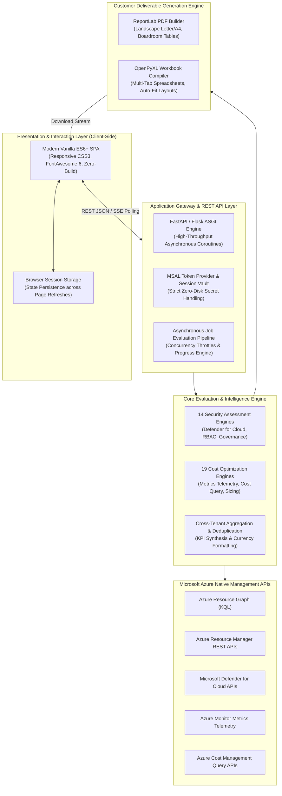

# Azure FinSecOps Platform - Enterprise Technology Stack & Architecture Specification

> **Document Version:** 2.0.0  
> **Target Audience:** Client Technical Leadership, Enterprise Architects, Security & FinOps Steering Committees  
> **Author:** Senior Project Delivery Manager & Principal Solution Architect  
> **Environment:** Hybrid Cloud / Microsoft Azure Enterprise Infrastructure  

---

## 1. Executive Summary & Platform Philosophy

The **Azure FinSecOps Platform** is an enterprise-grade cloud governance and financial optimization system engineered to deliver deep visibility, automated assessment, and verifiable savings across multi-tenant Microsoft Azure estates. 

Built with an **asynchronous-first architecture**, the platform connects directly to Azure native management backbones-including Azure Resource Graph (ARG), Azure Resource Manager (ARM), Microsoft Defender for Cloud, Azure Monitor, and Azure Cost Management-to evaluate infrastructure against 33 proprietary evaluation modules (14 Security Posture modules and 19 Financial Optimization modules).



---

## 2. Platform Technology Stack Breakdown

| Architectural Tier | Technology / Library | Version | Strategic Business Purpose |
| :--- | :--- | :--- | :--- |
| **Runtime & Language** | Python | 3.11+ | High-concurrency async coroutines, strict typing, and cross-platform reliability. |
| **Web & REST Framework** | FastAPI / Starlette / Flask | 0.110+ | Ultra-low latency asynchronous API endpoints, dependency injection, OpenAPI documentation. |
| **Authentication & IAM** | MSAL Python (`msal`) | 1.28+ | Microsoft identity platform OAuth2 Client Credentials flow; acquires ARM tokens without secret exposure. |
| **HTTP Transport Engine** | HTTPX (`httpx`) | 0.27+ | Asynchronous HTTP client with connection pooling, retries, and timeout management for Azure endpoints. |
| **Data Validation & Schemas** | Pydantic v2 & Pydantic-Settings | 2.6+ | Type-safe schema validation for cloud payloads, job state models, and environment settings. |
| **PDF Reporting Engine** | ReportLab | 4.1+ | Generates vector-grade, landscape boardroom PDF deliverables with custom tables and typography. |
| **Spreadsheet Engine** | OpenPyXL | 3.1+ | Generates formatted Excel deliverables with frozen headers, currency styling, and auto-sized columns. |
| **Frontend Framework** | Pure Vanilla JavaScript (ES6+) | Modern | Zero-build single-page architecture eliminating node_modules vulnerabilities and bundle compilation overhead. |
| **Styling & Design System** | Custom CSS3 + FontAwesome 6 | 6.5.1 | Custom design system with dark/light visual contrast, responsive grids, and font-based iconography. |
| **Configuration Engine** | Python Dotenv (`python-dotenv`) | 1.0+ | Production configuration via `.env` files with runtime fallback defaults. |

---

## 3. Deep Dive into Architectural Components

### 3.1 Asynchronous Backend & REST API Framework
* **FastAPI with ASGI Architecture (`uvicorn`):** Handles concurrent assessment queries across multiple subscriptions without blocking I/O threads.
* **Non-Blocking Network Layer (`httpx.AsyncClient`):** Communicates with Azure REST APIs over persistent HTTP/2 and HTTP/1.1 connections with TLS 1.3 encryption.
* **Fault-Tolerant Retry Matrix:** Built-in exponential backoff handles Azure ARM 429 (`TooManyRequests`) and transient 503 gateway drops.

```python
# Real Implementation Pattern: Scalable Azure Query Ingestion
async with httpx.AsyncClient(timeout=settings.azure_request_timeout_seconds) as client:
    response = await client.post(
        "https://management.azure.com/providers/Microsoft.ResourceGraph/resources?api-version=2021-03-01",
        headers={"Authorization": f"Bearer {token}"},
        json={"subscriptions": subscription_ids, "query": kql_query}
    )
```

### 3.2 Enterprise Azure Authentication & Security Vault
* **Microsoft Authentication Library (MSAL):** Implements OAuth 2.0 Confidential Client token acquisition targeting `https://management.azure.com/.default`.
* **Zero-Disk Secret Lifecycle:** Client secrets exist strictly in memory within transient task scopes; secrets are never serialized into logs, session stores, or client responses.
* **Granular Least-Privilege Support:** Functions cleanly under Azure built-in roles (`Reader`, `Cost Management Reader`, `Security Reader`).

### 3.3 Dynamic Reporting & Deliverable Generation Engine
The platform exports governance deliverables in two formats:
1. **Executive Landscape PDF (`ReportLab`):**
   - Engineered in landscape Letter format (792 pt $\times$ 612 pt) with precise 20 pt margins, giving 752 pt of usable width.
   - Flowable table layouts wrap long Azure resource IDs and resource group names cleanly.
   - Alternating row styling with primary color branding (`#4F46E5` Indigo for Security, `#EA580C` Rust Orange for Cost).
   - Dynamic currency symbols (`$`, `€`, `£`, `₹`, `A$`, `C$`) matching the tenant's billing profile.

2. **Multi-Tab Spreadsheet Deliverable (`OpenPyXL`):**
   - Separate worksheets for each individual assessment module containing all findings.
   - Executive Summary sheet with automated formula links.
   - Column dimensions auto-fitted based on cell string lengths.
   - Formatted numbers, currency columns, and severity-colored status flags.

### 3.4 Client-Side Single Page Application (SPA)
* **Zero-Build, Pure Standards Approach:** Native ES6+, HTML5, and CSS3 without npm/webpack build tools.
* **Persistent Tab & State Session (`sessionStorage`):** Refreshing the browser or navigating between tabs preserves tenant connection state, running job IDs, findings, and active tab selection.
* **Execution Safety Lockout:** During assessment execution, all execution triggers (`Run All`, `Run Security`, `Run Cost`, and card-level module buttons) are disabled via `.btn-disabled` (`pointer-events: none`).

---

## 4. Hardware & Deployment Recommendations

### 4.1 On-Premises or Cloud Container Deployment
* **Container Runtime:** Docker Engine 24+, Podman, or Azure Container Apps (ACA).
* **Base Image:** `python:3.11-slim-bookworm` (minimal footprint, hardened against common CVEs).
* **Compute Footprint:**
  - Minimum: 1 vCPU, 1 GB RAM (evaluates up to 5 subscriptions).
  - Recommended Enterprise: 2 vCPUs, 4 GB RAM (evaluates 50+ subscriptions concurrently).
* **Networking:** Outbound HTTPS (`TCP 443`) to:
  - `login.microsoftonline.com` (Azure AD token issuance)
  - `management.azure.com` (ARM and Azure Resource Graph)
  - `prices.azure.com` (Azure Retail Prices API)

---

## 5. Security & Compliance Safeguards

1. **Read-Only Inspection Guarantee:** The platform executes solely `GET` and read-only `POST` query operations. It contains no destructive API methods.
2. **Data Minimization:** No client customer payload data is inspected. Telemetry is limited to metadata (resource names, SKUs, performance metrics, and cost entries).
3. **Session Encapsulation:** In-memory job stores purge finished executions automatically after their configured TTL.
